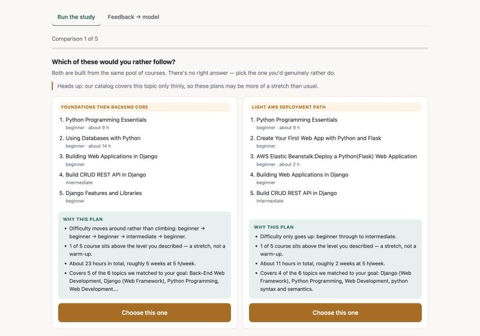

<!-- TITLE: Learning to Rank LLM-Generated Study Plans from Human Feedback -->
<!-- AUTHOR: Weibo Zheng -->
<!-- DEPARTMENT: The Department of Mechanical and Industrial Engineering -->
<!-- DEGREE: Master of Science -->
<!-- PROGRAM: Data Analytics Engineering -->
<!-- DATE: November 2026 -->
<!-- ADVISOR: Prof. Xuemin Jin -->

# Dedication

To those who kept asking what I was building, and listened to the answer.

# List of Acronyms

**API** Application Programming Interface
**AUC** Area Under the Receiver Operating Characteristic Curve
**AWS** Amazon Web Services
**BT** Bradley–Terry
**CDK** Cloud Development Kit
**CI** Confidence Interval
**DAG** Directed Acyclic Graph
**IPS** Inverse Propensity Scoring
**IRB** Institutional Review Board
**LinUCB** Linear Upper Confidence Bound
**LLM** Large Language Model
**MDP** Markov Decision Process
**MOOC** Massive Open Online Course
**OPE** Off-Policy Evaluation
**RLHF** Reinforcement Learning from Human Feedback
**SNIPS** Self-Normalised Inverse Propensity Scoring
**SVD** Singular Value Decomposition
**UCB** Upper Confidence Bound

# Acknowledgments

I thank my advisor, Prof. Xuemin Jin, for his guidance throughout this work.

*[One paragraph on your advisor, naming what he specifically did; one on
family. About 200 words. This is the only page in the thesis where you are
not making an argument — replace this placeholder before submission.]*

# Abstract of the Thesis

Large language models readily produce plausible study plans, but rank their own
output poorly. This thesis asks whether a reward model trained on human
preference feedback can select better plans than the language model's own
ordering, in a recommendation setting rather than a conversational one.

A catalog of 1,899 online courses in computer science, data science and software
development was assembled from three public sources, with an agent-derived
taxonomy of 188 skills and a 254-edge prerequisite graph. The reward function,
taxonomy and prerequisite graph were frozen and content-hashed as a single
bundle before any policy was run, removing the possibility of tuning the ground
truth after observing a result. An architectural firewall prevents any component
that produces a recommendation from reading the prerequisite graph, the reward
specification, or a learner's hidden state.

A generator writes six candidate study plans per learner from a 25-course
retrieved shortlist, and a reward model trained on pairwise preferences selects
among them. On held-out learners the preference model improves mean return over
the language model's own first choice by **+0.1136 ± 0.0745**, an effect that
survives a control separating *scoring* from *having more candidates*: selecting
randomly among six candidates is worse than taking the first (−0.1940 ± 0.1001).
A decomposition of the pipeline shows retrieval contributes most (+1.9828),
generation a real but smaller amount (+0.3707), and the language model's
self-ranking leaves +0.2872 unclaimed.

Two findings are of independent interest. The model trained on noisy pairwise
preferences slightly outperformed one regressed directly on the true reward
(0.7121 against 0.6819), indicating that learning from comparisons cost nothing
against learning from the answer key. The same model recovered a 4.6:1 asymmetry
between over- and under-challenging a learner without ever observing a reward
value, against a 3:1 asymmetry in the frozen specification.

Diagnostic work establishes that the selector sits at the ceiling of what a
linear model on seven features can achieve: perfect labels buy +0.003, additional
features reduce performance, and every variant falls within every other's
confidence interval. The remaining headroom is an evaluation-power problem before
it is a modelling one. The system was deployed as a web application with durable
event storage and an interface exposing how each recorded preference reshapes the
recommendation.

# 1 Introduction

Self-directed learners choosing from open online course catalogs face a
sequencing problem, not merely a selection problem. An individual course may be
well-reviewed and well-matched to a stated interest and still be the wrong thing
to take *next* — too advanced for the learner's current footing, redundant with
what they already know, or disconnected from the goal they are working toward.
The question "what should I learn next?" is a question about ordered paths, not
ranked items.

Large language models are unusually capable at producing such paths. Given a goal
and a shortlist of real courses, a model will readily write a coherent
five-course plan with a stated rationale. What it does less well is determine
which of several plans it has written is the best one. This thesis takes that gap
as its subject.

**Research question.** Does a reward model learned from human preference feedback
select better LLM-generated study plans than the language model's own ordering?

Three sub-questions follow. Where in a retrieve–generate–select pipeline does the
value actually originate (§4.2)? Can a reward model learn useful structure from
noisy pairwise preferences alone, without ever observing a reward value (§4.4)?
And what bounds the achievable gain — the quality of the feedback, the capacity
of the model, or the size of the evaluation (§4.6)?

**Contributions.** This thesis makes six contributions.

1. **A reproducible item space.** A 1,899-course catalog with an agent-derived
   188-skill taxonomy and a 254-edge prerequisite graph, built from three public
   sources, with every model call cached so that the construction replays offline
   with no API access.
2. **A pre-registration discipline for simulator studies.** The reward function,
   taxonomy and prerequisite graph are frozen and content-hashed as one bundle
   before any policy is run.
3. **An architectural firewall, and a measurement of its cost.** No component
   producing a recommendation may read the oracle structures. The cost of this
   discipline was measured rather than assumed, and found to be approximately
   zero.
4. **An empirical decomposition of a retrieve–generate–select pipeline**, showing
   that retrieval dominates, generation contributes a real but smaller amount,
   and the language model's self-ranking leaves measurable value unclaimed.
5. **Evidence that preference learning loses nothing to direct regression** on
   the same features, and recovers a difficulty asymmetry never shown to it.
6. **A deployed system** that collects real preferences and exposes, through an
   inspectable interface, how each reshapes the recommendation.

**Scope.** The item space is computer science, data science and software
development. The taxonomy and prerequisite graph are scaffolding for the
evaluation, not contributions in their own right; neither is validated against a
real curriculum or a domain expert.

**Every result in Chapter 4 rests on simulated preferences.** A live deployment
collects real ones, and 52 comparisons from 6 participants had been gathered at
the time of writing, but no reported contrast depends on them. They appear in
§5.6 as evidence bearing on the simulator's external validity — where they
partly disagree with it — rather than as a finding. §3.11 sets out which
experiment uses which population, and this distinction is drawn early because
the thesis is about learning from preferences and a reader is entitled to know
which preferences produced the headline number.

**Organization.** Chapter 2 situates the work in prior literature. Chapter 3
presents the methodology: catalog construction, reward specification,
pre-registration, the firewall, best-of-N selection, preference learning, and the
deployed system. Chapter 4 reports results. Chapter 5 discusses them and states
the limitations. Chapter 6 concludes.

# 2 Literature Review

## 2.1 Course and Learning-Path Recommendation

Recommendation for online learning is a well-surveyed field. Khalid, Lundqvist
and Yates [11] review the literature from 2012 to mid-2019 and find that work on
massive open online courses divides into several distinct recommendation
targets — courses, discussion threads, peers, learning elements and providers —
of which course recommendation is only one. Uddin et al. [12] reach a similar
partition in a systematic mapping review, and both note the same recurring
obstacles: sparse interaction data, cold start, and the absence of agreed
evaluation protocols.

**Why collaborative filtering is unavailable here.** The dominant technique in
the surveyed literature relies on learner–course interaction histories, whether
through matrix factorisation or neighbourhood methods. This thesis has no such
history. The catalog is assembled from public course metadata with no
enrolments, no completions and no ratings attributable to identified learners,
which is the cold-start condition in its strongest form. The approach taken here
is therefore content-based throughout: a plan is scored from properties of the
courses in it and the learner's stated profile, never from what similar learners
did.

**Items against paths.** The surveys above are concerned principally with
selecting *items*. A separate line of work addresses the ordering problem
directly. Nabizadeh et al. [13] survey learning-path personalisation and group
the methods into course generation, sequential pattern mining, and course
sequencing, treating a learning path as the realisation of a curriculum design.
Prerequisite structure is the usual mechanism by which ordering is constrained,
and Pan et al. [14] show that prerequisite relations between concepts can be
learned from MOOC course material itself rather than supplied by an expert — the
same premise the prerequisite graph of §3.3 rests on.

This section characterises the field at the level of its surveys. A fuller
treatment would compare named systems directly; the surveys are cited here
because the purpose is to locate this work rather than to adjudicate between
existing recommenders.

## 2.2 Contextual Bandits for Recommendation

A recommender that learns from its own output faces a problem a supervised
model does not: it only observes the outcome of the item it chose. Li et al.
[8] formalised news-article recommendation as a contextual bandit, in which a
policy sees a context, selects an arm, and observes a reward for that arm
alone. Their LinUCB algorithm assumes the expected reward is linear in the
context–arm features and selects the arm maximising an upper confidence bound,
so that uncertainty itself attracts exploration. The appeal for recommendation
is that exploration is directed rather than random: an arm is tried because
little is known about it, not because a coin came up heads.

Two properties carry into this thesis. First, the linear-payoff assumption
makes the learned weights inspectable, which matters when the question is what
a model learned rather than only how well it scored. Second, Li et al. showed
that a policy can be evaluated offline on logged data provided the logging
policy was stochastic and its action probabilities were recorded. A
deterministic policy logs probabilities of zero and one, and any later
importance-weighted estimate divides by zero or discards the record. That
constraint is why the deployed system of §3.10 samples its slates from a
softmax and stores the probability with which each was chosen.

The LinUCB baseline in §4.7 is included for a specific purpose: it establishes
that *learning* helps at all in this item space, separately from the question
of whether preference-based selection helps. Its margin over the fixed-weight
scorer (+0.2042, Cohen's *d* = 0.93) is the largest effect in the thesis, and
it sets the bar the later contrasts are read against.

## 2.3 Reinforcement Learning from Human Feedback

**From comparisons to a scale.** Bradley and Terry [1] addressed a problem in
experimental design: given only judgements of which of two items is preferred,
recover a scale on which the items can be ranked. Their model assigns each item
a latent quality and makes the probability of one beating another a logistic
function of the difference between them. The model is old, but its assumption —
that people compare more reliably than they rate — is what makes it useful
wherever absolute judgements are not comparable across judges.

**From a scale to a reward.** Christiano et al. [2] applied this to
reinforcement learning, showing that an agent could be trained against a reward
model fitted to human comparisons of short trajectory segments, without the
reward ever being specified. The significant result was efficiency: comparisons
on a small fraction of the agent's interaction were enough to learn behaviours
that would have been difficult to write a reward function for. Stiennon et al.
[3] carried the method to language, fitting a reward model to human comparisons
of summaries and optimising against it; Ouyang et al. [4] generalised this to
instruction following, in the training procedure now widely referred to as
RLHF.

**Learning a reward against learning a policy.** These works share a structure
worth separating. A reward model is learned from preferences, and then a policy
is optimised against that reward model, usually by a policy-gradient method.
The two halves are separable, and only the first is used here. This thesis
learns a reward model from preferences and applies it at inference time; no
policy is updated and no generator is fine-tuned. The generator in §3.7 is the
same model throughout, and what changes between conditions is only which of its
outputs is selected.

**Best-of-N as the selection rule.** Cobbe et al. [5] took that second route
explicitly: rather than optimising a model against a verifier, they sampled
many candidate solutions and returned the one the verifier ranked highest. On
grade-school mathematics this outperformed fine-tuning, and it scaled better
with additional data. Best-of-N is attractive because it is cheap, leaves the
generator untouched, and makes the contribution of the scorer directly
measurable — the same candidates can be re-ranked by any rule. The difference
in setting is that Cobbe et al. could in principle check a verifier against
ground truth, because arithmetic has a right answer. A study plan does not,
which is what makes a preference-trained scorer the appropriate instrument
rather than a convenience.

## 2.4 Language Models as Planners and as Rankers

The premise of this thesis is a gap between two capabilities that are easily
conflated: producing a plausible plan, and recognising which of several plans
is best.

On the first, the evidence is mixed in an instructive way. Valmeekam et al. [6]
introduced PlanBench to evaluate language models on planning and reasoning
about change, and found that models produce plans that read fluently while
failing formal validity far more often than their fluency suggests. The
relevant observation for this work is not that models plan badly in the
classical-planning sense, but that *surface plausibility and correctness come
apart* — a plan can be well-formed, well-motivated and wrong.

On the second, Huang et al. [7] examined whether language models can improve
their own reasoning by self-correction, and found that without external
feedback they generally cannot; performance sometimes degrades after a
self-correction pass. The failure is one of self-evaluation rather than
generation: the model produces a candidate it cannot reliably assess.

Put together, these suggest a division of labour — generate with the model,
evaluate with something else — and that is the structure adopted here. The
contribution of §4.2 is to measure the size of the gap in this setting rather
than assume it: the generator writes six plans and places one first, and the
best of its six is worth **+0.2872** more than the one it chose. That quantity
is the headroom everything after §4.3 attempts to recover.

## 2.5 Off-Policy Evaluation

A deployed recommender accumulates logs under whichever policy was running, and
the natural question is what a *different* policy would have achieved on the
same traffic. Inverse propensity scoring answers this by reweighting each
logged outcome by the ratio of the probability the new policy would have chosen
that action to the probability the logging policy actually did. The estimate is
unbiased when every action the new policy might take had some chance of being
logged.

That condition is easy to violate. Swaminathan and Joachims [9] showed that the
unbiased estimator suffers what they termed propensity overfitting when used
for learning over rich hypothesis spaces: the optimiser is drawn toward
policies that concentrate mass on a few heavily-weighted logged examples. Their
self-normalised estimator divides by the sum of the importance weights,
trading a small bias for a large reduction in variance.

Two consequences shape the design here. A deterministic policy assigns
probability one to its chosen action and zero to everything else, which makes
the importance ratio either undefined or degenerate — so the deployed system
samples from a softmax over scores and records the resulting probability
vector, as described in §3.10. And because propensity-weighted estimates become
unreliable when overlap is poor, no off-policy estimate is reported in this
thesis; the logging exists so that such an analysis is possible once enough
impressions under a stochastic policy have accumulated, which they have not.
This is stated as a limitation rather than presented as an omission.

## 2.6 Research Gap

Three literatures meet in this thesis and none of them covers the junction.

Preference-based reward modelling [2]–[4] is well established for *generated
text*, where a model produces a response and annotators compare responses.
Inference-time selection against a learned scorer [5] is likewise established,
but has been applied chiefly to problems with a verifiable answer, such as
mathematical reasoning, where a verifier can in principle be checked against
ground truth. A study plan has no verifiable answer. It is judged by fit to a
person, which is exactly the setting preference learning was designed for and
exactly the setting in which best-of-N selection has been least examined.

Course recommendation [11], [12] overwhelmingly ranks items rather than paths,
and the learning-path literature [13] constructs sequences from prerequisite
structure rather than learning which of several plausible sequences a learner
would prefer. Neither treats the ordered plan as the unit a reward model scores.

Finally, the evidence that language models plan competently [6] sits alongside
evidence that they evaluate their own output poorly [7]. That pairing implies an
opening — generate with the model, select with something else — but it has been
pursued mainly in verifiable domains, not in recommendation.

**The gap, stated plainly.** No existing work learns a reward model from human
preferences over *ordered recommendations drawn from a fixed catalog*, where the
action space is combinatorial, an item's value depends on what preceded it, and
no ground-truth answer exists against which a verifier could be calibrated. This
thesis occupies that gap, and §4.2 establishes that the opening it assumes is
real: the generator's own ranking leaves +0.2872 of measurable value unclaimed.


# 3 Methodology

This chapter is organized as follows. We first describe the construction of the
item space: source selection, cleaning, deduplication, the skill taxonomy, the
prerequisite graph, and the simulated learner population. We then present the
reward specification and the pre-registration and firewall disciplines that
govern its use. We describe the retrieve–generate–select pipeline and the
preference learning that drives selection, followed by the online update rule
used with real feedback. Finally we describe the deployed system and its logging.

## 3.1 Dataset and Catalog Construction

Three public datasets were used [15]–[17], each in a distinct role.

| Source | Rows | Role | Licence |
|---|---|---|---|
| Coursera 2021 | 3,522 | Spine — the only source pairing full descriptions with skill tags | Unknown |
| Coursera 2025 | 3,404 | Donor — duration and review counts; never creates a row | Apache-2.0 |
| Coursera hours | 9,595 | Donor — joins on URL slug; real effort hours | CC0-1.0 |

**Donor semantics.** A donor never adds a course; it fills a gap in a spine row
that already exists. The slug-joinable hours dataset matched 58.1% of the spine,
and the title-and-institution matched 2025 snapshot matched 20.4%. Together they
raised effort-hours coverage from approximately 22% to 56.2%. Every donated field
records its provenance, because a merged row otherwise cannot answer where a
given difficulty level originated.

**Excluded sources.** Two further datasets were evaluated and excluded. The edX
dataset contributed no skills that survived filtering and introduced provider
leakage: field coverage differed so sharply by platform that a classifier could
identify the provider from the feature vector alone (AUC 1.000). Dropping it
removed the confound by construction. The Udemy dataset offers 22,000 rows but no
descriptions, skill tags or difficulty levels; including it would have left
roughly 85% of the item space title-only and reduced any result to a measurement
of which platform documents its courses more thoroughly.

## 3.2 Cleaning, Deduplication and Scope

The issues addressed below were observed in the data rather than anticipated.

**Encoding.** Detection initially rejected UTF-8 because the source contains
baked-in replacement characters, fell through to cp1252, and mis-decoded the
corpus; a text-repair library then masked the damage. Correcting the detection
revealed that 52.5% of descriptions contain unrecoverable damage introduced at
scrape time.

**Sentinel values.** Strings such as `Not Calibrated`, `Mixed` and `NA` map to
null with an explicit missingness flag rather than being imputed. Imputing the
mode would manufacture a correlation between difficulty and popularity that then
propagates into any difficulty-sensitive reward term.

**Duration.** Effort hours and calendar weeks are retained as separate fields.
Converting between them requires an hours-per-week assumption, which is a
property of the learner rather than the course.

**Ratings.** Empirical-Bayes shrinkage toward the provider mean, weighted by
review count, with a missingness indicator retained.

**Attrition.** A three-band cascade (exact slug, then normalised title and
institution, then fuzzy and embedding match) collapsed 160 duplicate rows into
3,362 canonical courses. Subject classification then selected the in-scope arms.

| Step | Remaining |
|---|---|
| Spine rows | 3,522 |
| Canonical after deduplication | 3,362 |
| After subject classification | **1,899** |

Nothing is deleted. Out-of-scope rows remain in the catalog flagged as such, so
the attrition is auditable rather than asserted.

## 3.3 Skill Taxonomy and Prerequisite Graph

**Families.** Fifteen families were authored by hand. A taxonomy's top level is a
decision the thesis should be able to defend, not an artifact of whichever course
happened to be processed first. Each family carries a scope note and in/out
boundary examples.

**Leaves.** A model read each course's title, description and raw tags and
proposed short skill labels. These were normalised with a token-sorted merge key,
so that "automated testing" and "testing automated" collide; blocked to avoid
quadratic comparison; and merged in three bands, where high agreement merges
automatically with no model call, a borderline middle band is adjudicated, and
the remainder stays separate. 188 leaves survived, covering 4,182 assignments
over 1,431 courses. A final filter removed 419 assignments (9.1%) whose label was
not semantically close to the course's own text, which is what strips tags such
as "Mergers & Acquisitions" from a Git course.

**Prerequisite edges.** Two independent methods proposed edges. An agent read the
frozen skill labels family by family and proposed a partial order (151 edges). A
statistical pass identified skills that consistently appear on harder courses
than skills they co-occur with (115 edges). After deduplication 259 candidates
remained; 5 were dropped to enforce acyclicity, leaving 254 edges. Where the two
methods agree (7 edges) the graph is strongest; where they point in opposite
directions (3 edges) it is weakest, and this is reported rather than silently
resolved.

**Study plans.** Topologically sorting the graph produced 122 study plans
averaging 13.6 milestones. An earlier construction built one plan per family and
produced 15 shallow plans, too short for sequencing to matter; building plans as
goal-ancestor closures produced the required depth.

## 3.4 Simulated Learner Population

The population comprises 500 learners, each with a goal, starting level, weekly
hour budget and already-mastered skills (2.8 on average).

The level mix is stratified rather than catalog-matched (200 beginner, 175
intermediate, 125 advanced). The catalog is 49% beginner, and a matched
population would leave the difficulty term inert for most learners: measured
directly, two reward specifications differing 2.7-fold on the over-challenge
weight produced identical top-10 lists for a beginner, diverging only for an
advanced learner. Goals are round-robined across families, after an earlier run
produced a population in which one family never appeared as any learner's goal.

## 3.5 Reward Specification and Pre-Registration

In a simulator study the reward function *is* the ground truth. Tuning its
weights after observing that a policy underperforms would invalidate the result
entirely. The weights are therefore frozen and content-hashed before any policy
runs, together with the taxonomy and prerequisite graph, because altering either
would change what the reward means while leaving the reward's own hash unchanged.

The bundle reported throughout is `poc-v6-stratified`, hash `54539899ab24e4b4`.
It weights topic match, difficulty fit, time fit, course quality, metadata
completeness and goal progress; the full specification appears in Appendix A.

The load-bearing choice is asymmetry: over-challenging a learner costs three
times more than under-challenging them (0.45 against 0.15). A symmetric penalty
makes the optimal policy level-neutral, which erases the sequencing behaviour
under study.

## 3.6 The World–Agent Firewall

No component that produces a recommendation may read the prerequisite graph, the
reward specification, or a learner's hidden state. This is enforced by a
build-time assertion that tracks actual file reads rather than by convention.

The motivation is circularity. Prerequisite edges are partly derived from
difficulty levels, which are also what the recommender scores on. If those edges
reached the recommender's features while the reward credited prerequisite
satisfaction, the system would succeed by construction and the result would be
empty.

The cost of this discipline was measured rather than assumed. A feature exposing
the oracle graph to the reward model was implemented and evaluated; its learned
weight was −0.011, statistically indistinguishable from zero, and the headline
result moved from +0.1051 to +0.1013. The firewall costs nothing in this setting,
which is a finding rather than an assumption.

## 3.7 Retrieval, Generation and Plan Features

**Retrieval and generation.** A learner's query is embedded and the 25 nearest
courses are retrieved from the 1,899. The generator sees only that shortlist and
the learner's profile, and writes six distinct five-course plans, each ordered
and each with a named strategy. Course identifiers outside the shortlist are
dropped rather than repaired, so the generator cannot introduce a course that
does not exist.

**Plan diversity.** Cosine similarity on the feature vectors reads approximately
0.99 and is uninformative, since those vectors are mostly positive and share a
constant bias term, making a near-unit reading inevitable. Measured as Jaccard
overlap on course sets:

| Comparison | Mean Jaccard | Detail |
|---|---|---|
| Within one learner, across six plans | 0.255 | 1.4% identical; 90.5% share under half |
| Across two learners, best-matching plan | 0.035 | 85.6% share no course at all |

**Features.** Each plan is described by seven observable features: mean topic
match, mean over-challenge, mean under-challenge, goal coverage, mean rating,
position-weighted difficulty, and a bias term. The set is deliberately
order-sensitive: without position-weighted difficulty, a permutation of the same
five courses scores identically and the model cannot express "foundations first".
Introducing ordering-aware features is what moved the headline result from *not
established* to established. A larger fifteen-feature set was implemented and
evaluated; the seven above were selected by ablation rather than by inspection of
weights (§4.6).

## 3.8 Preference Learning

A learner cannot supply a number. Asking for a rating produces a quantity that is
not comparable between people. What people do reliably is compare, and a
comparison is anchored because both plans were shown to the same person at the
same moment. The Bradley–Terry model [1] gives

```
P(plan a preferred over plan b) = sigma( theta · (phi_a − phi_b) )
```

Fitting is logistic regression in which each training row is the *difference*
between two plans' feature vectors and the label is a single bit. Features are
z-scored on the training split before differencing.

Three consequences follow from training on the difference. **The learner
cancels**: a person who is hard to please depresses both plans equally, and that
term vanishes in the subtraction. This is also why pairs are built within one
learner and never across two — a cross-learner pair would reintroduce exactly
what the subtraction removes, and the model would learn who is easy to please
rather than what makes a plan good. **A constant carries no information**: the
fit has no intercept, and although the feature vector contains a constant bias
term the fit assigns it +0.000, exactly as the algebra requires. **Only ordering
is identifiable**: scaling theta leaves the ranking unchanged, so the model
learns a ranking rule, which is all that best-of-N selection requires.

**Simulated preference noise.** Offline, a simulated learner comparing two plans
selects the genuinely better one with probability `sigma(1.5 × (R_a − R_b))`.
Near-identical plans approach a coin flip; clearly different ones are ranked
reliably. Across the reported run, simulated learners chose correctly 64% of the
time. This noise is deliberate: a model trained on noiseless preferences would
appear far stronger than anything a person produces, and the result would not
transfer. Each learner contributes all 15 pairs from their six plans.

## 3.9 Online Updating from Real Feedback

The offline model is fitted on 1,800 simulated comparisons. A small number of
real participants cannot produce a comparable sample, and a batch refit from a
cold start on a few dozen pairs would sit near zero and change nothing
observable. The deployed system therefore starts from the offline weights as a
prior, applies one gradient step per comparison, and anchors back toward the
prior:

```
theta <- theta + lr * [ (1 − p) * x  −  anchor * (theta − prior) ]
where x = phi_chosen − phi_rejected,  p = sigma(theta · x)
```

The gradient is self-scaling: a comparison the model already predicts correctly
moves it barely at all, while one it predicts wrongly moves it substantially. The
anchor term ensures a single anomalous response cannot erase the offline fit.

State is not stored. Theta is replayed from the event log on every read, so
concurrent workers cannot diverge, a restart loses nothing, and the full update
history is available for inspection at no additional cost.

A caveat belongs with the step size. Larger steps make a handful of
comparisons visible in the ranking, but they do not make the resulting
estimate more reliable; the rule exists to demonstrate the mechanism on a
small sample, not to extract a statistically meaningful fit from one.

## 3.10 System Implementation and Deployment

**Pipeline.** Eleven build stages run from raw download to a validated, hashed
catalog. Every model response is cached by a hash of model, prompt and
temperature, so the pipeline replays offline with no API access. The build gate
runs 17 assertions and exits non-zero on violation, including acyclicity of the
prerequisite graph, bijection of the arm index, feature-matrix hash agreement,
and the namespace firewall.

**Serving.** The deployed application presents a single task: a learner states a
goal, level and weekly hours; the system retrieves, generates six plans, scores
them with the live reward model, and presents two at a time for comparison.
Pairwise comparison is the collection format because it is exactly what the
Bradley–Terry fit consumes. Each plan is shown with a rationale assembled from
measured facts — level sequence, total hours against the stated budget,
goal-skill coverage — rather than generated prose, because a generated
explanation could describe a plan that is not the plan being shown. Model scores
are withheld from the interface, since telling a participant which plan the model
preferred converts their judgement into agreement.

**Domain gating.** A catalog restricted to computing cannot answer every query,
and the scope classifier admitted some finance and business courses (§5.5). A
query for stock trading therefore retrieved real but useless courses with high
confidence. Course-level similarity does not discriminate: "how to trade stocks"
scores 0.722 against the nearest course, above "become a backend web developer"
at 0.702. Skill-level similarity does. A query is accepted when its mean
similarity to the top six matched taxonomy skills exceeds 0.49; measured over 14
in-domain and 8 out-of-domain queries, the in-domain floor is 0.506 and the
out-of-domain ceiling 0.477. The margin is thin, and the threshold is placed just
below the in-domain floor rather than midway because the errors are asymmetric:
refusing a genuine participant costs a session, while an over-generous plan costs
one comparison the participant can reject.

**Logging.** Three event kinds are recorded append-only: the full set of
generated plans with their features, each pairwise choice with the order of
presentation, and any reason given. Logging the full candidate set, not only the
displayed pair, allows the analysis to distinguish "this plan lost" from "this
plan was never offered". Recording presentation order allows position bias to be
measured rather than absorbed into the preference signal. Slates are sampled from
a softmax over scores rather than taken deterministically, so each impression
carries the probability with which it was chosen; a deterministic policy logs
propensities of 0 and 1, which makes any later off-policy estimate degenerate.

**Deployment.** The application runs on AWS App Runner from a container image,
with DynamoDB for event storage and Secrets Manager for credentials, defined as
infrastructure as code. Spend caps are enforced server-side and before the paid
call, because the API budget is fixed and a public endpoint cannot rely on human
monitoring.

## 3.11 Experimental Design: Populations, Splits and Procedure

Three experiments appear in Chapter 4, on different populations and
different units of analysis. They are set out together here because the
differences are easy to miss and they explain why sample sizes vary
between tables.

| | Baseline family (§4.7) | Best-of-N (§4.3–4.6) | Randomized-graph ablation (§4.8) |
|---|---|---|---|
| Population | 500 simulated learners | first 200 of the same 500 | the same 500 |
| Seeds | 5 (7, 11, 23, 37, 53) | 1 (7) | 5 |
| Unit of analysis | learner × seed → 2,500 rows | learner → 200, of which **80 held out** | learner |
| What varies | the policy | the selection rule over identical candidates | the prerequisite graph |
| What is held fixed | learners, reward, catalog | learners, candidates, reward | learner id, level, hours, budget, plan depth |
| Model fitting | none — policies learn online | 120 train / 80 test, split by learner | none |

**Why 200 and not 500 for best-of-N.** Each learner requires one plan
generation call, and the candidate plans must be generated before any
selection rule can be compared. 200 was chosen as the point at which the
contrast was measurable within the project's API budget; §4.6 shows this
was the binding constraint on what the experiment could resolve.

**Why the split is by learner and not by plan.** All six plans for one
learner share that learner's goal, level and budget. Splitting by plan
would place plans from the same learner on both sides of the split, and
the reward model would be scored partly on learners it had already seen.

**Where the two reported numbers come from.** §4.2 reports means over all
200 learners, because no model is fitted there — it compares retrieval and
generation against random baselines, and every learner can be used. §4.3
onward reports the 80 held-out learners only, because from that point a
model has been fitted and the training learners are no longer independent.
This is why §4.2 gives the LLM's first plan as 0.5200 and §4.4 gives it as
0.5985: the same quantity on 200 learners and on the 80-learner test
subset.

**Feedback sources, and which results rest on which.**

| Source | What it is | Which results use it |
|---|---|---|
| Simulated preferences | A logistic function of the true return gap, correct 64% of the time (§3.8) | **All of Chapter 4.** Every reported contrast. |
| Real preferences | 52 comparisons from 6 participants through the deployed service | **No result in Chapter 4.** Reported in §5.6 as evidence about the simulator, not as a finding. |

No number in Chapter 4 depends on human feedback. This is stated plainly
because the thesis is about learning from preferences, and a reader is
entitled to know that the preferences producing the headline result were
generated rather than collected.


**Inspector.** A second interface exposes the mechanism under study. It shows the
offline prior against the current weights, the reordering those weights produce
on a recorded plan set, and every update in sequence with the model's prior
belief and the resulting weight movement. The quantity it makes visible is
*surprise* — how wrong the model was about which plan a person would choose.
Across a demonstration session, surprise fell from 0.35 on the first comparison
to 0.09 on the fifth as the model acquired the participant's preference for
gentler plans, with the over-challenge weight moving from −0.84 to −1.26.




# 4 Results

All results are reported against the frozen bundle `poc-v6-stratified`. Intervals
are 95% and computed on paired per-learner differences; every policy is evaluated
on the same learners with the same reward.

## 4.1 Experimental Setup

**Evaluation protocol.** Each policy is evaluated on identical learners with
identical candidate plans, so that only the selection rule differs. Contrasts are
paired within learner, which removes variance arising from learners differing in
goal depth, starting level and hour budget. A 95% interval that spans zero is
reported as *not established* regardless of the sign.

**Splits.** The best-of-N experiment uses 200 learners, 120 for training the
reward model and 80 held out; §4.2 reports over all 200 because no model is
fitted there, and §4.3 onward over the 80 held-out learners only. The baseline
family uses the full 500-learner population across five seeds, giving 2,500
learner-runs per policy. §3.11 sets out every population and unit of analysis
in one table.

**A note on win rates.** Baseline contrasts are paired at the (learner, seed)
level, giving n = 2,500. `reports/statistical_analysis.md` pairs the same
contrasts per learner after averaging over seeds, giving n = 500 and higher
win rates (95% against 80% for learning). The means are identical; the
dispersion is not, because averaging removes seed noise. This thesis quotes the
per-learner-seed figures throughout. `reports/evidence_audit.md` reconciles the
two.

**Reproducibility.** Plans replay from the response cache, so the diagnostic
analyses underlying §4.2 and §4.6 make zero API calls and produce byte-identical
output under two different Python interpreters.

## 4.2 Where the Value Originates

Measured on 200 learners, every variant scored by the same frozen reward:

| Variant | Mean return |
|---|---|
| Best of 40 random 5-course plans, whole catalog (1,899) | −1.1869 |
| Best of 40 random 5-course plans, from the 25-course shortlist | +0.7959 |
| Best of 6 random 5-course plans, from the shortlist | +0.4365 |
| The language model's first plan | +0.5200 |
| Best of the language model's six | +0.8072 |

| Stage | Difference | 95% CI | Win rate |
|---|---|---|---|
| Retrieval (shortlist vs whole catalog) | +1.9828 | ±0.0660 | 100% |
| Generation (six generated vs six random from the same shortlist) | +0.3707 | ±0.0605 | 84% |
| Ordering (best of six vs the one placed first) | +0.2872 | ±0.0435 | 74% |

**Retrieval dominates.** Random plans drawn from the whole catalog score deeply
negative, while the same procedure restricted to 25 relevant courses scores
strongly positive. The single largest effect in the system is narrowing the
candidate pool before the language model sees it.

**Generation contributes, when compared fairly.** The generator adds +0.371 over
random draws from the same shortlist. The comparison must be like-for-like:
against forty random draws the six generated plans appear to be a wash (+0.807
against +0.796), but a maximum over forty draws exceeds a maximum over six of
almost anything. Both rows are reported.

**Ordering motivates the thesis.** The model writes six plans and places one
first. The best of the six is worth +0.287 more than the one it chose. The
language model cannot reliably rank its own output, and that gap is the headroom
a learned reward model attempts to capture.

## 4.3 Preference Model Quality

On 200 learners and 1,200 generated plans, the preference model achieves held-out
pairwise accuracy of 0.602 and correlation with true return of r = 0.857. The
accuracy figure should be read against the 64% label-noise ceiling established in
§3.8, not against 1.0.

## 4.4 Selection by Learned Reward

| Selection policy | Mean return |
|---|---|
| The language model's first plan | 0.5985 |
| A random one of its six | 0.4045 |
| Chosen by the feedback-trained reward model | **0.7121** |
| Chosen by a model regressed on the true reward | 0.6819 |
| The best of the six (ceiling) | 0.8438 |

| Contrast | Difference | 95% CI | Win rate | Verdict |
|---|---|---|---|---|
| Feedback RL over raw language model | +0.1136 | ±0.0745 | 51% | established |
| Scoring over sampling | +0.3075 | ±0.0995 | 70% | established |
| More candidates alone, without scoring | −0.1940 | ±0.1001 | 25% | established |
| Headroom remaining | +0.1317 | ±0.0465 | 48% | established |

**The principal result.** The feedback-trained model outperforms the raw language
model and the interval excludes zero.

**The control gives it meaning.** Generating more candidates and selecting
randomly is worse than taking the first plan. The gain is therefore not
attributable to having more options; it is specifically attributable to the
scoring.

**The win rate understates the effect.** A selector that selects the language
model's own first plan produces a difference of exactly zero, counted as a
non-win. This occurs for 24% of held-out learners — the model agreeing, not
failing. Among the 76% where it overrides:

| Quantity | Value |
|---|---|
| Win rate when it overrides | 67% (41 of 61) |
| Mean gain when it overrides | +0.1489 |
| Mean when it wins | +0.3459 |
| Mean when it loses | −0.2549 |

The model intervenes on roughly three learners in four, is correct two times in
three when it does, and its wins exceed its losses in magnitude. Both framings
belong in the reporting: 51% is the honest headline across all learners, and the
decomposition is what the figure means.

## 4.5 What the Model Learned

| Feature | Weight |
|---|---|
| Mean over-challenge | −0.838 |
| Position-weighted difficulty | +0.368 |
| Goal coverage | +0.366 |
| Mean topic match | +0.313 |
| Mean under-challenge | −0.184 |
| Mean rating | +0.182 |
| Bias | +0.000 |

From noisy pairwise preferences alone, with no access to the reward
specification, the model learned that over-challenging a learner is 4.6 times
worse than under-challenging them. The frozen reward encodes a 3:1 asymmetry. The
model recovered the correct shape and modestly overshot the magnitude. It also
learned that difficulty should rise across a plan — sequencing behaviour emerging
from preferences rather than being specified.

Separately, the preference-trained model slightly outperformed the model
regressed directly on the true reward (0.7121 against 0.6819), although that
difference is not established. Learning from noisy comparisons cost nothing
measurable against learning from the answer key.

## 4.6 What Bounds the Gain

The selector captures approximately 49% of available headroom. Four candidate
explanations were separated by measurement, all selecting from the same six
candidate plans on the same held-out learners:

| Variant | Gain | 95% CI | Headroom captured |
|---|---|---|---|
| Linear, seven features (reported) | +0.1194 | ±0.0754 | 48.7% |
| Noiseless preference labels | +0.1220 | ±0.0760 | 49.7% |
| All fifteen aggregate features | +0.0984 | ±0.0769 | 40.1% |
| Plus per-position difficulty and topic | +0.1323 | ±0.0733 | 54.0% |

Perfect labels buy +0.003, so feedback quality is not the binding constraint.
Additional aggregate features reduce performance. Interaction and squared terms
were also evaluated and moved nothing. The training curve across 30, 60 and 120
learners (29%, 43%, 49% captured) is flattening rather than climbing, and L2
strength was swept across two orders of magnitude without effect.

Decisively, every variant falls inside every other variant's confidence interval,
and that interval is roughly half the size of the effect being measured. With 80
held-out learners the experiment cannot distinguish these options; resolving a
+0.013 difference would require approximately two orders of magnitude more
learners. The remaining headroom is therefore an evaluation-power problem before
it is a modelling one, and 49% is the ceiling for this design rather than slack
to be engineered away.

## 4.7 Baseline Policy Family

Course-by-course policies over 500 learners and five seeds:

| Contrast | Difference | 95% CI | Win rate |
|---|---|---|---|
| Learning (bandit over fixed scorer) | +0.2042 | ±0.0130 | 80% |
| Planning (lookahead over bandit) | +0.0640 | ±0.0206 | 53% |

Learning clearly helps. Planning is statistically established and practically
negligible: a 53% win rate and an effect size near 0.075 means the lookahead wins
barely more often than a coin flip. With 2,500 learner-runs almost any effect
clears significance, which is why win rate and effect size are reported alongside
the interval.

One negative result is reported here and explained in §5.3: every policy that
earns more reward makes less goal progress (−0.036 to −0.085, all established).

## 4.8 Randomized-Graph Ablation

Three populations, identical in learner identity, starting level, weekly hours
and budget; only the graph from which goals and starting mastery derive differs.

A confound required removal first. Degree-preserving swaps preserve each skill's
in- and out-degree but lengthen paths, raising mean plan depth from 8.7 to 12.8.
Each learner is therefore matched to the random plan closest in depth to the real
plan they would have received, bringing assigned depth to 7.7 in both arms.

| Policy | Real − random | 95% CI | Verdict |
|---|---|---|---|
| Fixed-weight baseline | +0.0347 | ±0.0478 | not established |
| LinUCB | +0.0549 | ±0.0451 | established |
| Planner | +0.0552 | ±0.0442 | established |

The gate passes narrowly, and only for the policies that learn. For the
fixed-weight baseline the difference is not established, which is coherent: a
policy with frozen weights has no mechanism to exploit prerequisite structure.
That both learning policies show the effect while the non-learning one does not
is the pattern one would expect if the graph carries genuine signal. Passing this
gate establishes that the graph beats noise; it establishes nothing about
contamination, which only the firewall addresses.

# 5 Discussion

## 5.1 Preference Learning Did Not Cost Accuracy

The most striking result is §4.5: a model trained on comparisons that were wrong
36% of the time matched, and slightly exceeded, one trained on true reward values
using the same features. Two explanations are available and the present data does
not separate them. The ranking objective may suit a ranking task better than
squared error does, since predicting the order is an easier problem than
predicting the value. Alternatively, the noise may act as regularisation at this
sample size. Distinguishing these is a natural next experiment, and §6.2 proposes
a design.

## 5.2 On the Firewall

The firewall was expected to cost accuracy and did not (§3.6). Stated positively:
a recommendation system can be prevented from reading the ground truth against
which it is evaluated without paying for the discipline. In this setting the
information the oracle graph carried was already present in observable difficulty
ordering, which also explains why the position-weighted difficulty feature
carries substantial weight.

## 5.3 Reward Misspecification Is Visible, and Instructive

Every policy that earns more reward makes less goal progress. Diagnosis showed
this is not a tuning error but a specification gap:

| Quantity | Value |
|---|---|
| Goal skills per learner | 1.0 — each learner has exactly one |
| Therefore goal progress is | binary, with no partial credit |
| Courses touching the goal set | 1.3% |
| Mean goal term | +0.0070 |
| Mean over-challenge term | −0.1401, i.e. 20 times larger |
| Terminal completion weight | 0.0 — completion pays nothing |

Each learner's goal is the single terminal milestone of their study plan, so the
term is inactive on 99% of courses while difficulty, topic and time are live on
all of them. Policies trading goal progress for reward are responding correctly
to this reward. Presented as a finding rather than a defect, this is a clean
demonstration of specification gaming [10] in a recommendation setting.

The remedy has two parts and requires both. Defining the goal as the *path* to
the milestone rather than its endpoint raises the goal set from 1 skill to a mean
of 12.5, makes the term fire twelve times more often, and makes progress graded
over roughly 11 steps. That alone does not rescale the term, because the overlap
measure divides by the number of skills still needed; a terminal payout for
attainment is what makes completion worth the detour, and it becomes a meaningful
signal only once progress is graded. Any such change requires freezing a new
bundle and re-running, and the terminal weight must be derived from a stated
principle and frozen before the run.

## 5.4 Why Planning Underperforms

Planning beats the bandit by a statistically established but practically
negligible margin. The likely reason is §5.3: nothing in the present reward
requires lookahead. A sparse terminal payout would create a credit-assignment
problem that a bandit structurally cannot solve and a planner can, and is the
most plausible route to making the planning contrast meaningful.

## 5.5 Limitations

**Simulation.** Every reported number is measured against a reward function
written for this thesis. The reward model learning from noisy preferences is a
realistic setup; the preferences themselves are not real people's. This is the
largest threat to validity and is not mitigated by anything else in this list.
§5.6 gives it substance rather than leaving it abstract: on 52 real
comparisons the fitted weights disagree with the simulated ones in sign on
goal coverage and under-challenge, which is the strongest available evidence
that the simulator and real learners do not value the same things.

**Generated scaffolding.** The taxonomy and prerequisite graph are
model-generated and validated against neither a real curriculum nor a domain
expert.

**Unvalidated scope classifier.** The 3,362 to 1,899 filter has an audit sample
prepared but unlabelled, so its precision and recall are unreported. The
consequence is observable: finance courses sit in the pool classified under
programming and machine-learning families, which is what made the domain gate of
§3.10 necessary.

**Catalog recency.** The snapshots span 2020 to 2024, so the item space
under-represents exactly the topics a current learner most wants; the
natural-language and large-language-model family holds only 26 courses.

**Imputation and damage.** Difficulty and duration are substantially imputed and
missingness correlates with provider; 52.5% of descriptions carry unrecoverable
encoding damage inside text that feeds the embeddings.

**Selector ceiling.** The selector captures approximately 49% of available
headroom, and §4.6 establishes that this is a ceiling for the design rather than
slack.

**Goal progress.** Weak across every policy, for the reasons given in §5.3.

**Real feedback is demonstration, not evidence.** The deployed system collects
genuine preferences, but 52 comparisons across 6 participants cannot support a
statistical claim about seven weights.

**Position bias in the collected preferences is uncorrected.** The left-hand
plan was chosen 65% of the time. Left–right assignment is not randomised per
comparison, so a material share of the collected signal reflects layout rather
than judgement. This limits §5.6 specifically and should be fixed before any
further collection.

**Ethical review.** Data collection from human participants beyond the author and
supervisor was not undertaken within the scope of this work.

## 5.6 What the Collected Preferences Suggest About the Simulator

52 pairwise comparisons were collected from 6 participants through the
deployed service. This is far too little to fit seven weights — 36 training
pairs — and **nothing in this section is a result**. It is, however, the only
evidence the project holds on whether simulated preferences resemble real
ones, and it does not fully agree.

| Feature | Simulated fit | Fitted on 52 real comparisons |
|---|---|---|
| Mean over-challenge | −0.838 | −0.260 |
| Mean under-challenge | −0.184 | **+1.091** |
| Goal coverage | +0.366 | **−1.520** |
| Mean topic match | +0.313 | −0.020 |
| Mean rating | +0.182 | +0.137 |
| Position-weighted difficulty | +0.368 | +0.105 |

Three observations. Real participants preferred *easier* plans: the
under-challenge weight flips from a penalty to the largest positive
coefficient. Goal coverage flips sign — the frozen reward pays for covering
skills the learner lacks, and participants chose against it, plausibly because
a plan covering more goal skills is necessarily broader and harder, in which
case the two effects are one preference measured twice. And held-out accuracy
on real preferences was 0.750 against 0.602 on simulated, so participants were
*more* self-consistent than the 64%-accurate noise model assumes.

**The caveat that limits all of this.** The left-hand plan was chosen 65% of
the time. Position bias of that magnitude means a material share of the signal
is layout rather than judgement, and randomising left–right assignment per
comparison is a prerequisite for interpreting any of these weights. It is a
small change to the study application and has not yet been made.

Taken together this bears directly on Limitation 1 below. It does not
invalidate Chapter 4, whose claims are explicitly about learning from
simulated preferences, but it does suggest the frozen reward encodes a
preference for goal coverage that the people tested did not share.

# 6 Conclusion

## 6.1 Summary

A reward model trained on noisy pairwise preferences selects better
LLM-generated study plans than the language model's own ordering, by +0.1136 ±
0.0745 on held-out learners, with a control establishing that the gain arises
from scoring rather than from the availability of more candidates. The model
recovers a difficulty asymmetry it was never shown, and loses nothing against a
model regressed directly on the true reward.

The decomposition in §4.2 locates the value: retrieval dominates, generation
contributes substantially, and the language model's self-ranking leaves
measurable value unclaimed. That unclaimed value is what preference learning
recovers, and §4.6 establishes how much of it is reachable with this design —
approximately half, with the remainder bounded by the size of the evaluation
rather than by the model.

Two results qualify the claim and both are worth carrying forward. The
randomized-graph ablation (§4.8) passes only for the policies that learn,
which is the pattern a genuine signal would produce but a narrow one. And the
52 real comparisons in §5.6, while far too few to fit a model, disagree with
the simulated preferences on the sign of goal coverage. The method works on
the preferences it was given; whether those preferences resemble a learner's
is the question the next study has to answer.

## 6.2 Future Work

**Repair the goal specification** (§5.3) and re-run as a new frozen bundle. This
is the highest-value change available: it addresses an established negative
result and is the most plausible route to making the planning contrast
meaningful.

**Separate the two explanations in §5.1** — ranking objective against noise as
regularisation — with a sample-size sweep at matched label noise.

**Collect real preferences at scale, with left–right randomised.** The
deployed system, the logging and the online update path all function, and 52
comparisons have been gathered. Two changes make further collection worth
doing: randomising which plan appears on the left, which §5.6 shows is
currently confounding the signal at 65/35, and obtaining ethical approval for
participants beyond the author and supervisor. Several hundred judgements
would convert the central claim from reinforcement learning from simulated
feedback to reinforcement learning from human feedback.

**Validate the scope classifier** against the prepared audit sample, closing the
one unmeasured step in the data chapter.

# Bibliography

Each entry was checked against the publisher's or arXiv's own record. Three
carry title discrepancies between the preprint and the proceedings version;
these are noted inline so the reader can match whichever is cited.

## Preference-based reward modelling

[1] R. A. Bradley and M. E. Terry, "Rank analysis of incomplete block designs:
I. The method of paired comparisons," *Biometrika*, vol. 39, no. 3/4, pp.
324–345, 1952. doi: 10.2307/2334029.

[2] P. F. Christiano, J. Leike, T. B. Brown, M. Martic, S. Legg, and D. Amodei,
"Deep reinforcement learning from human preferences," in *Advances in Neural
Information Processing Systems 30*, 2017, pp. 4299–4307.

[3] N. Stiennon, L. Ouyang, J. Wu, D. Ziegler, R. Lowe, C. Voss, A. Radford,
D. Amodei, and P. F. Christiano, "Learning to summarize from human feedback,"
in *Advances in Neural Information Processing Systems 33*, 2020.
arXiv:2009.01325.
*(The NeurIPS proceedings title reads "with human feedback"; the arXiv version
reads "from". Match whichever you cite.)*

[4] L. Ouyang, J. Wu, X. Jiang, D. Almeida, C. L. Wainwright, P. Mishkin,
C. Zhang, S. Agarwal, K. Slama, A. Ray, J. Schulman, J. Hilton, F. Kelton,
L. Miller, M. Simens, A. Askell, P. Welinder, P. Christiano, J. Leike, and
R. Lowe, "Training language models to follow instructions with human feedback,"
in *Advances in Neural Information Processing Systems 35*, 2022.
arXiv:2203.02155.

## Inference-time selection

[5] K. Cobbe, V. Kosaraju, M. Bavarian, M. Chen, H. Jun, L. Kaiser,
M. Plappert, J. Tworek, J. Hilton, R. Nakano, C. Hesse, and J. Schulman,
"Training verifiers to solve math word problems," arXiv:2110.14168, 2021.
*(The arXiv metadata lists seven authors and the PDF twelve; check the PDF
header before citing.)*

## Language models as planners and rankers

[6] K. Valmeekam, M. Marquez, A. Olmo, S. Sreedharan, and S. Kambhampati,
"PlanBench: An extensible benchmark for evaluating large language models on
planning and reasoning about change," in *Advances in Neural Information
Processing Systems 36*, Datasets and Benchmarks Track, 2023, pp. 38975–38987.
arXiv:2206.10498.

[7] J. Huang, X. Chen, S. Mishra, H. S. Zheng, A. W. Yu, X. Song, and D. Zhou,
"Large language models cannot self-correct reasoning yet," in *International
Conference on Learning Representations (ICLR)*, 2024. arXiv:2310.01798.

## Contextual bandits and off-policy evaluation

[8] L. Li, W. Chu, J. Langford, and R. E. Schapire, "A contextual-bandit
approach to personalized news article recommendation," in *Proceedings of the
19th International Conference on World Wide Web (WWW '10)*, 2010, pp. 661–670.
doi: 10.1145/1772690.1772758.

[9] A. Swaminathan and T. Joachims, "The self-normalized estimator for
counterfactual learning," in *Advances in Neural Information Processing Systems
28*, 2015.

## Reward specification

[10] J. Skalse, N. Howe, D. Krasheninnikov, and D. Krueger, "Defining and
characterizing reward hacking," in *Advances in Neural Information Processing
Systems 35*, 2022. arXiv:2209.13085.
*(The NeurIPS proceedings title reads "Reward Gaming"; the arXiv version reads
"Reward Hacking".)*

## Course and learning-path recommendation

[11] A. Khalid, K. Lundqvist, and A. Yates, "Recommender systems for MOOCs: A
systematic literature survey (January 1, 2012 – July 12, 2019)," *The
International Review of Research in Open and Distributed Learning*, vol. 21,
no. 4, pp. 255–291, 2020. doi: 10.19173/irrodl.v21i4.4643.

[12] I. Uddin, A. S. Imran, K. Muhammad, N. Fayyaz, and M. Sajjad, "A systematic
mapping review on MOOC recommender systems," *IEEE Access*, vol. 9, pp.
118379–118405, 2021. doi: 10.1109/ACCESS.2021.3101039.

[13] A. H. Nabizadeh, J. P. Leal, H. N. Rafsanjani, and R. R. Shah, "Learning
path personalization and recommendation methods: A survey of the
state-of-the-art," *Expert Systems with Applications*, vol. 159, art. 113596,
2020. doi: 10.1016/j.eswa.2020.113596.

[14] L. Pan, C. Li, J. Li, and J. Tang, "Prerequisite relation learning for
concepts in MOOCs," in *Proceedings of the 55th Annual Meeting of the
Association for Computational Linguistics (Volume 1: Long Papers)*, Vancouver,
Canada, 2017, pp. 1447–1456. doi: 10.18653/v1/P17-1133.

## Datasets

[15] K. Kapoor, "Coursera Courses Dataset 2021," Kaggle, 2021. Licence:
unspecified. [Online]. Available:
https://www.kaggle.com/datasets/khusheekapoor/coursera-courses-dataset-2021

[16] Yosefxx590, "Coursera Courses and Skills Dataset 2025," Kaggle, 2024.
Licence: Apache-2.0. [Online]. Available:
https://www.kaggle.com/datasets/yosefxx590/coursera-courses-and-skills-dataset-2025

[17] E. Rustam, "Coursera Dataset," Kaggle, 2024. Licence: CC0-1.0. [Online].
Available: https://www.kaggle.com/datasets/elvinrustam/coursera-dataset

Dataset licences and field inventories were verified against the live Kaggle
pages on 20 September 2026 and are recorded in `config/sources.yaml`. Entry
[15] carries no stated licence, which is why no raw text from it is
redistributed with this work.

# A Supplementary Tables

## A.1 Frozen Reward Specification

Bundle `poc-v6-stratified`, hash `54539899ab24e4b4`.

| Weight | Value | Rationale |
|---|---|---|
| Topic match | 1.00 | The stated goal is the primary signal; scaled to ~29% of total reward spread |
| Over-challenge | 0.45 | A one-level overshoot costs as much as the entire topic range |
| Under-challenge | 0.15 | One third of the over-challenge weight; a symmetric penalty would erase sequencing |
| Time fit | 0.15 | Over-budget penalised, clipped at twice the learner's budget |
| Quality | 0.10 | Ratings are selection-biased popularity, so the contribution is clipped |
| Missing metadata | 0.05 | A small cost per missing field, so a course cannot win on silence |
| Goal overlap | 0.55 | Overlap with goal skills the learner still lacks |
| Dense goal credit | 0.00 | Disabled in this bundle |
| Terminal completion | 0.00 | Disabled in this bundle; see §5.3 |

Term shares of total reward spread over the arm pool: level 29%, topic 29%, time
19%, quality 16%, missing metadata 7%.

## A.2 Evidence Map: Which Source Supports Each Result

Every numeric claim in Chapter 4 is recomputed from its source and compared
against the text by `python -m pipeline.evidence_audit`, which writes
`reports/evidence_audit.md` and exits non-zero on any disagreement. At the
time of writing it verifies **45 of 45** headline claims.

| § | Result | Source of truth |
|---|---|---|
| 3.1–3.2 | 1,899 arms; 3,522 → 3,362 → 1,899 attrition | `data/agent/arm_features.parquet`, `reports/attrition_funnel.md` |
| 3.3 | 188 skills; 254 edges; 122 plans | `data/catalog/skills.parquet`, `data/world/skill_prereqs.parquet`, `data/world/study_plans.parquet` |
| 3.4 | 500 learners, stratified 200/175/125 | `data/world/users.parquet`, `reports/simulator.md` |
| 3.5 | Frozen weights, hash `54539899ab24e4b4` | `reports/preregistration_poc-v6-stratified.md` |
| 4.2 | Retrieval +1.9828, generation +0.3707, ordering +0.2872; plan diversity | `reports/stage1_evidence.md` |
| 4.3–4.4 | Policy means; all four paired contrasts; the tie decomposition | `data/agent/bestofn_selection_poc-v6-stratified.parquet`, `reports/bestofn_poc-v6-stratified.md` |
| 4.5 | Learned weights; the 4.6:1 asymmetry | `data/agent/reward_model_poc-v6-stratified.json` |
| 4.6 | Selector ceiling; label-noise, feature and regularisation ablations | `reports/stage1_diagnosis.md` |
| 4.7 | Learning and planning contrasts; per-seed means | `data/agent/experiment_poc-v6-stratified.parquet`, `reports/experiment_poc-v6-stratified.md` |
| 4.8 | Randomized-graph ablation, depth-matched | `reports/ablation_randomized_graph.md` |
| 5.3 | Goal-term diagnosis | `reports/stage1_diagnosis.md` |
| 5.6 | 52 real comparisons; weights fitted on them; position bias | `reports/real_feedback.md` |
| — | All contrasts with paired Cohen's *d* | `reports/statistical_analysis.md` |

### A.2.1 One quantity reported two ways

`reports/statistical_analysis.md` pairs the baseline contrasts per learner
after averaging over seeds (n = 500); `reports/experiment_poc-v6-stratified.md`
pairs them per learner-seed (n = 2,500). The means are identical. The win
rates are not — 95% against 80% for learning, 60% against 53% for planning —
because averaging over seeds removes noise that would otherwise flip the sign
of a small difference.

Both are defensible. Averaging first treats a learner as the unit of
observation, which is what a learner is; pairing per seed treats each run as
an observation, which gives a larger sample at the cost of treating correlated
runs as independent. **This thesis quotes the per-learner-seed figures
throughout**, and `reports/evidence_audit.md` records the reconciliation so
the difference is not discovered as a contradiction.

## A.3 Reproducibility Map

| Claim | Source |
|---|---|
| Catalog construction, coverage, damage | `reports/catalog_summary.md`, `reports/merge_report.md` |
| Attrition 3,522 to 1,899 | `reports/attrition_funnel.md` |
| Taxonomy, 188 leaves | `reports/taxonomy.md` |
| Prerequisite graph, 254 edges, 122 plans | `reports/prereqs.md` |
| Learner population | `reports/simulator.md` |
| Frozen reward weights and rationale | `reports/preregistration_poc-v6-stratified.md` |
| Retrieval, generation, ordering; plan diversity | `reports/stage1_evidence.md` |
| Headline best-of-N result | `reports/bestofn_poc-v6-stratified.md` |
| Selector ceiling; goal-term diagnosis | `reports/stage1_diagnosis.md` |
| Randomized-graph ablation | `reports/ablation_randomized_graph.md` |
| Bandit and planner baselines | `reports/experiment_poc-v6-stratified.md` |

The test suite comprises 194 tests. The contract test asserting that the serving
feature order matches the order in which the reward model was fitted is the most
load-bearing: were those to diverge, every plan would still score, every number
would still look plausible, and the wrong plan would rank first.
